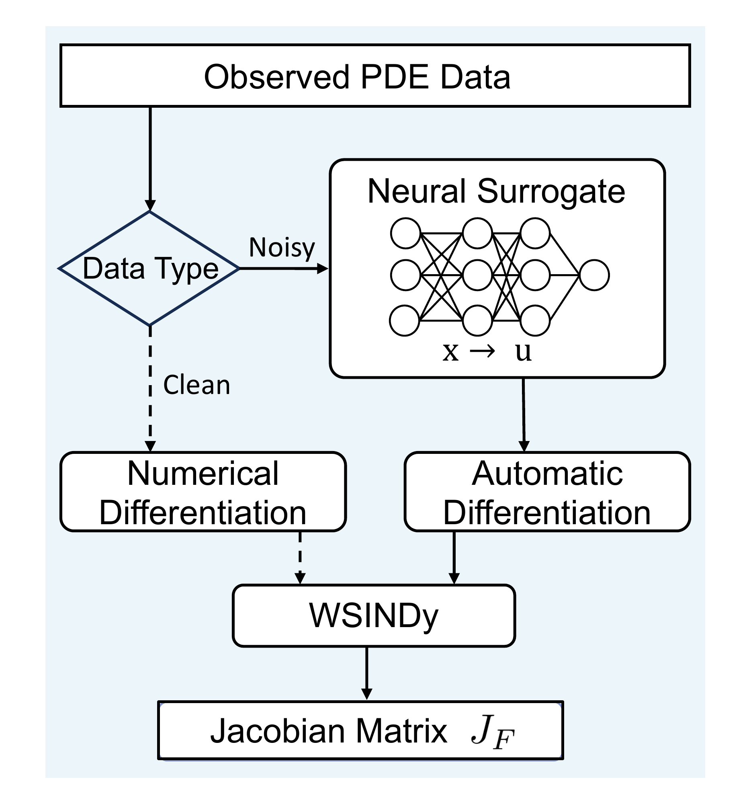
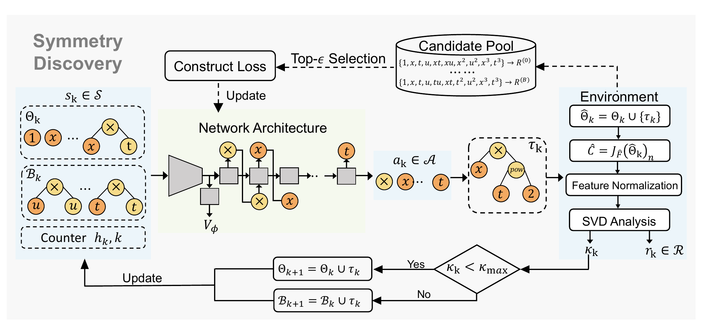

# LieDiscover

Discover symbolic Lie symmetries from PDE data.

Use Python 3.10. Run these commands from the repository root:

```bash
conda create -n lie-pde python=3.10 -y
conda activate lie-pde
python -m pip install -r requirements.txt
```

The examples use CPU (`--gpu -1`). Use `--gpu 0` with a CUDA-enabled PyTorch installation.

## 1. Data Generation

Generate independent training, validation, and test trajectories, together with the derivatives needed for symmetry discovery:

```bash
python generate_pde_data.py --task burger
```

Available tasks: `burger`, `heat`, `kdv`, `wave`, `rd`, `schrodinger`, `damped_burger`, and `forced_transport`.
Replace `burger` in the commands and paths below to use another task.

Data are saved in `data/<task>/`; full trajectories for equation fitting are saved in `data/raw/<task>/`.
Use `--n-ics`, `--n-val-ics`, and `--n-test-ics` to set the number of trajectories (defaults: 10, 2, and 2).

## 2. Jacobian Computation

<p align="center">
  
</p>

*Figure 2. Prepare the data, identify the equation, and compute its Jacobian.*

Fit an explicit PDE with WSINDy:

```bash
python wsindy.py --task burger --seed 0 \
  --output result/wsindy_residual/burger_0/wsindy.json
```

The search loads this equation through `wsindy_source.py` and uses automatic differentiation to compute the Jacobian of its residual. No separate Jacobian command is needed.
This release implements the clean-data branch of Figure 2; the noisy-data experiments are not included.

## 3. Symmetry Discovery



*Figure 1. Build a symbolic library, evaluate its symmetries, and update the search policy.*

Run the symbolic search, then prune the library and export the generators:

```bash
python lie_discover.py burger --seed 0 --gpu 0
python pruning_and_visualize.py burger --seed 0 --gpu 0 \
  --reuse-generator --generator-path vis/burger_0/generator.pt
```

The search combines the equation Jacobian with prolonged library terms and finds symmetry generators from the resulting matrix's numerical null space.
Pruned results are saved in `vis/burger_0_pruned/`, including `generator.pt`, `theta_terms.txt`, and figures. Policy checkpoints are saved in `checkpoints/rs_ac/burger_0/`.


## 4. PDE Solving

Use the discovered generators to augment trajectories and train a Fourier Neural Operator (FNO). This stage supports the paper's three equations: **Burgers (`burger`), Heat (`heat`), and KdV (`kdv`)**.

```bash
python -m LPSDA.train_fno --pde burger --seed 0 --gpu 0 \
  --generator-path vis/burger_0_pruned \
  --train_samples 10 --num_epochs 40 \
  --n_transform 16 --sigma 0.3 --p_original 0.5 \
  --exp_name burger_0
```

For Heat or KdV, replace `burger` in the task, generator path, and run name after completing the previous stages for that equation. `--sigma` controls augmentation strength; the example value is configurable, not a claim of reproducing every paper result.

The solver selects a checkpoint using validation loss and evaluates it on the test split. The model, metrics, and augmentation report are saved under `result/pde_solving/exp_fno_burger/burger_0/`. 


